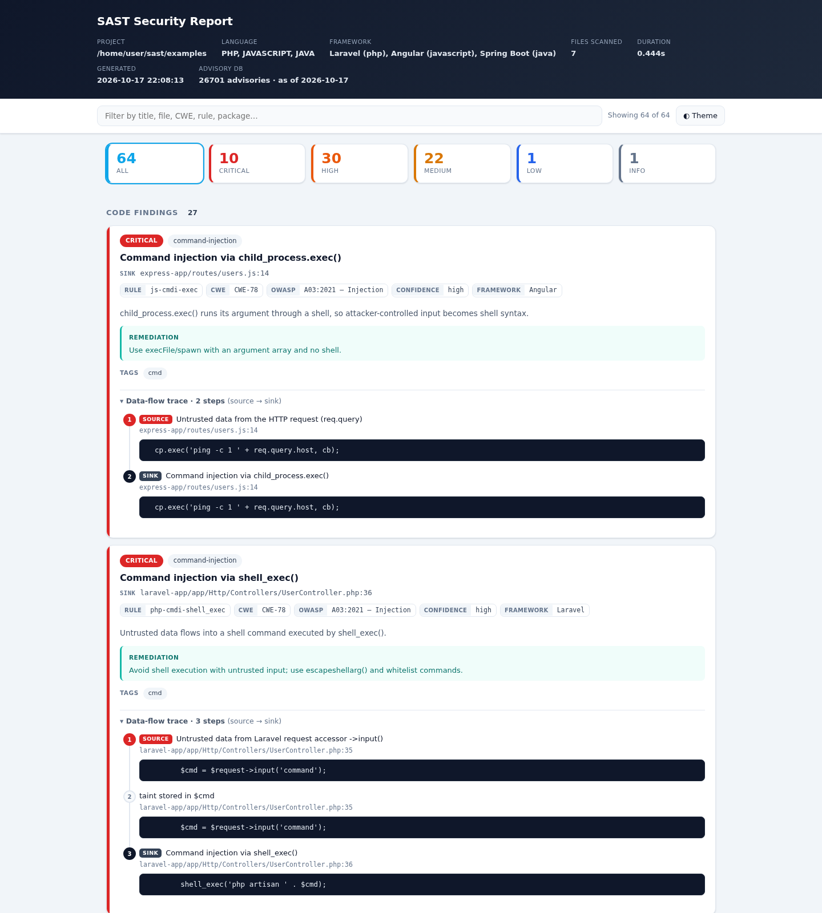
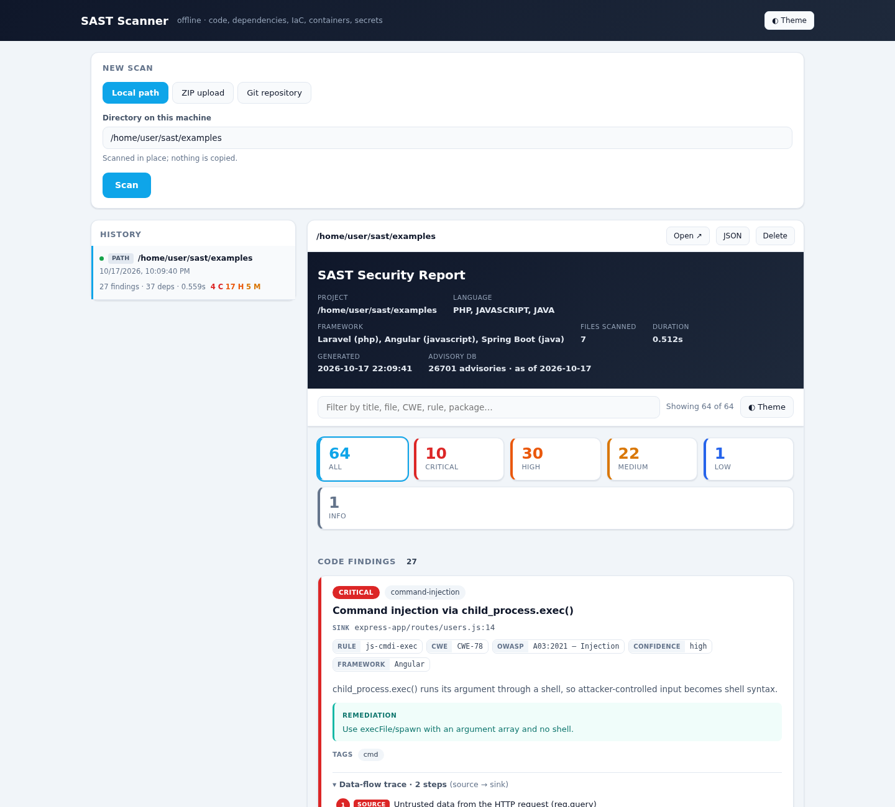

# sast — Static Analysis & Surface Testing


`sast` is a security scanner that works its way through a codebase and hands
back one report covering every part of it: application code, third-party
dependencies, infrastructure-as-code, Dockerfiles, templates and hard-coded
secrets. It runs entirely offline and ships as a single binary, so there is
nothing to install and nothing to phone home to.



## What it does

- **Eight languages**, analysed framework-aware. PHP (Laravel, Symfony), Java
  (Spring, Spring Boot, Jakarta EE), JavaScript and TypeScript (Node, Express,
  React, Angular, Next.js, NestJS, Vue), Python (Django, Flask, FastAPI), Go
  (net/http, Gin, Echo, Fiber, Gorilla), C# (ASP.NET), and C/C++ for memory
  safety. The framework is detected from your manifests, so the rules match
  what you actually wrote.
- **Source-to-sink taint analysis.** Data is tracked from where it enters (a
  request parameter, a superglobal, an environment read) through assignments,
  concatenation and calls, until it reaches a sink like `eval`, `system`, a
  raw SQL query or `innerHTML`. Every finding carries the full path it took to
  get there.
- **Dependencies, ranked by whether you use them.** A vulnerable package in a
  lockfile is only interesting if your code reaches it. Findings are marked
  `called`, `imported` or `unused`, and the report puts the ones your code
  actually invokes first.
- **The other surfaces.** Secrets across every text file, Terraform and
  Kubernetes misconfigurations, Dockerfile problems and base-image CVEs, and
  template/config issues — all in the same pass as the code scan.
- **Confidence that means something.** `$_SERVER` is modelled key by key, and
  data read from a database, session or file reports at lower confidence than
  direct request input. A sanitizer with a known bypass downgrades a finding
  instead of pretending it fixed it.

## Quick start

Python 3.10+ to install, nothing at scan time.

```bash
pip install -e .
sast scan /path/to/project -o report.html
```

```bash
# JSON or SARIF (SARIF goes straight into GitHub code scanning)
sast scan /path/to/project --format json
sast scan /path/to/project --format sarif -o results.sarif

# Fail CI when anything at or above a severity is found
sast scan . --format sarif -o results.sarif --fail-on high
```

## Building a single binary

```bash
make                 # download feeds + build (default)
make feeds           # only refresh the OSV feeds
make build           # only build dist/sast (Linux) or dist/sast.exe (Windows)
make test            # run the unit test suite
make smoke           # run the built binary against one fixture per engine
```

The result contains the tool and the advisory database. `make smoke` matters
because the unit tests import the Python package, not the executable; a
missing grammar or data file would pass them and still break for users, so CI
runs the smoke test on both platforms before uploading an artifact. Re-run
`make` now and then to refresh the embedded vulnerability data.

## Language coverage

| Language | Frameworks |
|---|---|
| PHP | Laravel, Symfony, raw |
| Java | Spring, Spring Boot, Jakarta EE, raw |
| JavaScript / TypeScript | Node, Express, React, Angular, Next.js, NestJS, Vue |
| Python | Django, Flask, FastAPI, raw |
| Go | net/http, Gin, Echo, Fiber, Gorilla |
| C# | ASP.NET Core, ASP.NET, raw |
| C / C++ | memory safety, raw |

The four scanners that need no source language at all (IaC, containers,
secrets, dependencies) run regardless of what languages are present.

## What it finds

### Code

Interprocedural, sanitizer-aware, with a trace from source to sink for every
finding. The rule set covers the OWASP Top 10 plus the framework-specific
surfaces:

- SQL injection (raw `mysqli`/PDO, Laravel `DB::raw`/`whereRaw`, Doctrine DQL,
  JDBC/JPA/JdbcTemplate, `knex.raw`/`sequelize.query`), NoSQL injection, command
  injection, LDAP, SpEL and XPath.
- XSS through `echo`/`print`, Blade `{!! !!}`, servlet response writers,
  `innerHTML`, `document.write`, React `dangerouslySetInnerHTML`, Angular
  `bypassSecurityTrust*`, and the Node `res.*` sinks.
- SSRF, path traversal, open redirect, insecure deserialization, XXE, mass
  assignment, prototype pollution, JWT `alg:none`, permissive CORS and weak
  crypto.
- C/C++ memory safety: unsafe APIs (`gets`, `strcpy`, `sprintf`), tainted
  format strings and copy lengths, allocation-size bugs, and a dedicated
  checker for use-after-free, double-free and memory leaks.
- Division by zero, both the literal case and a divisor an attacker
  controls — one request is enough to crash the process.

### Attack surface

Before the findings, the scanner maps the application's HTTP entry points —
the first thing an audit builds by hand. It reads the route constructs of the
detected framework (Spring `@*Mapping` and servlets, Express/Koa/Fastify,
Flask/FastAPI/Django, Gin/Echo/Gorilla, Laravel/Symfony, ASP.NET including
WebForms code-behind, and raw PHP files served by path) and reports each as
method, path, handler and any authorisation guard found in scope.

Two things follow from it:

- **Findings are tied to the request that reaches them.** A finding stops
  reading "SQL injection at `Foo.java:42`" and becomes `POST /api/user`,
  parameter `name`, with a `curl` skeleton that targets exactly that input.
  The skeleton marks the parameter; it does not ship a payload — confirming
  the bug is the tester's call.
- **Findings are ranked by exposure.** A bug on a route with no guard found
  sorts above the same bug behind an authorisation check, ahead of severity,
  because it is where an unauthenticated audit starts.

On guards the tool states only what it saw: a route with none found is
reported as "no guard found", never as "unauthenticated". Authorisation can
live in a servlet filter, a security config, a reverse proxy or a gateway,
none of which is visible at the route declaration — so absence of a detected
guard is a lead to check, not a conclusion.

### Broken access control (opt-in: `--audit`)

OWASP A01 is the largest category in the Top 10 and the one taint analysis
cannot reach: the code is dangerous for what it *fails* to do, so there is no
sink. What is tractable is the shape of the omission, and `--audit` reports
two of them as **candidates for a human to triage**, never as conclusions:

- **IDOR** — an object identifier the client supplies is used to read or
  write that object. Reported higher when nothing in the handler consults the
  logged-in user, and lower when it does, because a handler that reads the
  session may still compare against the wrong thing.
- **Missing authorization** — a state-changing route with no guard, where
  neighbouring routes declared alongside it *do* have one. The inconsistency
  is the signal; an application that guards nothing is not reported at all.

This is off by default and deliberately so. It trades precision for recall,
which is what an auditor reading a report once wants, and the opposite of
what belongs in a build gate — so `--audit` keeps it out of CI by
construction.

Measured by hand against the known labs: it finds the IDOR in NodeGoat
allocations and benefits, dvna's `modifyProductSubmit` and `userEditSubmit`,
govwa's `idor1`/`idor2`, and all three unscoped note operations in
dvws-node, plus the unauthenticated `POST /v2/admin/create-user` whose
neighbours all carry `validateToken`. BenchmarkJava's 2740 servlets produce
none, which is the point: they read parameters and run SQL all day, but
their parameters are not named like object identifiers.

### Dependencies

`composer.lock`, `pom.xml`/`build.gradle`, and `package-lock.json`/`yarn.lock`/
`pnpm-lock.yaml` are matched against the bundled advisory database with
semantic version ranges. Each finding is classified by reachability:

| State | Meaning |
|---|---|
| `called` | the package is imported **and** a symbol the advisory names is invoked |
| `imported` | the package is imported, so the vulnerable version is loaded |
| `unused` | no first-party import found |

A called medium outranks an unimported critical. `--ignore-unreachable` drops
the unused ones entirely, and each verdict carries its evidence so you can
check it rather than trust it.

### Secrets

Searched across every text file, because a credential is as dangerous in a
README or CI config as in source. Hidden directories are skipped except the
ones that hold pipelines or credentials (`.github`, `.gitlab`, `.circleci`,
`.aws`, `.docker`, `.kube` and similar), so a token in a workflow file is
found while `.git`, `.venv` and build caches stay out. Two approaches: about 22 provider patterns
(AWS, GitHub, GitLab, Slack, Stripe, Google, OpenAI, Anthropic, npm, PyPI,
SendGrid, Twilio, Azure, private keys, JWTs, database URIs) matched by their
issuer-defined shape, plus Shannon entropy over credential-shaped assignments.
Placeholders and low-variety values are suppressed, and secret values are
redacted before they ever reach a report.

### Infrastructure as code

Terraform/HCL, Kubernetes, CloudFormation, Helm and docker-compose: world-open
security groups, public buckets, publicly accessible databases, unencrypted
storage, wildcard IAM actions and principals, IMDSv1, privileged containers,
host namespaces and mounted Docker sockets.

### Containers

Dockerfile analysis (root user, unpinned base image, secrets baked into
layers, `curl | sh`, `ADD` from a URL, disabled package verification) plus
base-image CVE matching: the `FROM` line is treated as a dependency and matched
against distro advisories. A CycloneDX or SPDX SBOM is read when present.

### Templates and configuration

Rendering and deployment posture live outside `.php` and `.java` files: Twig
(`|raw`), JSP (`<%= %>`, `<c:out escapeXml="false">`), Thymeleaf (`th:utext`),
FreeMarker (`#noescape`), Blade (`{!! !!}`), plus `.env`,
`application.properties`, `web.xml` and `php.ini` for debug flags, exposed
actuators, disabled TLS and committed secrets.

## Reports

HTML (a single self-contained file), JSON, and SARIF 2.1.0. SARIF drops
straight into GitHub code scanning and any other SARIF-aware tool.

The HTML report is built to be worked through rather than just read:

- **Triage.** Mark each finding **real**, **to investigate** or **false
  positive**, filter to any of those (or to what you have not reviewed yet),
  and export the verdicts as JSON. A dismissed finding stays on the page,
  struck through and dimmed, instead of vanishing.
- **Category filter.** One toggle per rule category — injection, memory
  safety, access control, misconfiguration and so on — all on by default,
  with All/None. They are independent toggles, so narrowing to two related
  categories works, which a single-choice filter cannot do.
- Severity chips and full-text search, all four filters combining.

Verdicts are keyed on a fingerprint built from the rule, the relative path
and the text of the offending line — not the line number — so they survive a
re-scan that shifts code around. Served by `./sast server`, they are stored
in the scan history and shared between reviewers; opened as a local file,
they fall back to that browser's storage, and the report says which of the
two it is doing.

## Web interface

`sast server` serves a browser UI that scans a local path, an uploaded ZIP, or
a git repository, and shows the report on the same page. History is kept in
SQLite under `~/.sast` and survives restarts.

```bash
sast server                      # http://127.0.0.1:8000
sast server --port 9000 --data-dir /var/lib/sast
```



It is built on `http.server` from the standard library; adding a web framework
would have cost the tool its defining property of running offline with nothing
installed.

There is no authentication, so the bind address is the security boundary. It
listens on `127.0.0.1` by default, and `--host 0.0.0.0` prints a warning.
Regardless of bind address, the `Host` header is checked (DNS-rebinding
protection) and state-changing requests must be same-origin. A server bound
to all interfaces answers at the IP address it was reached on, since a bare
IP cannot be rebound; any other name must be the machine's own hostname.

Two scans run at a time and up to eight wait in a queue; past that the server
answers `503` with `Retry-After` rather than starting unbounded work. Deleting
a scan that is queued or still running discards it and its triage verdicts. The inputs are
attacker-shaped and treated that way: ZIP entries with traversal or symlinks
are refused, git clone runs through an argument list rather than a shell with
schemes allow-listed, and local paths are resolved and reported unambiguously.

## CI gating

`sast scan` exits 0 by default. `--fail-on` flips that:

```bash
sast scan . --format sarif -o results.sarif --fail-on high
```

Anything at or above the threshold — code findings and vulnerable dependencies
both — makes the command exit 1. A scan that could not run as asked exits 2
instead: a path that is not a directory, or an `--advisory-db` that is
missing or not valid JSON, so a typo cannot pass the gate by quietly
checking dependencies against less data than intended.

## Usage reference

```bash
# Minimum severity (applies to code findings and dependencies alike)
sast scan /path/to/project --min-severity high

# Extra advisory databases (repeatable)
sast scan /path/to/project --advisory-db my-advisories.json --advisory-db more.json

# Scope and limits
sast scan . --include-tests          # scan test code too (excluded by default)
sast scan . --max-file-size 5        # skip source files over 5 MB (default: 2)
sast scan . --max-files 1000         # cap files scanned per language

# Dependency reachability
sast scan . --ignore-unreachable     # drop what nothing imports
sast scan . --no-reachability        # skip the analysis

# Run only certain scanners
sast scan . --only iac --only secrets
sast scan . --no-containers

# Import an OSV / NVD feed offline
sast import-feed osv-feed.json -o advisories.json
sast import-feed nvdcve.json --package-map cpe-map.json -o advisories.json

# Refresh the embedded vulnerability data
sast fetch-feeds --ecosystems Packagist Maven npm PyPI Go NuGet
```

Polyglot projects are handled in one pass: every language present is scanned,
and frameworks are detected from module manifests anywhere in the tree, so a
monorepo resolves Laravel and Spring Boot per module rather than reporting
everything as raw.

## How it works

1. Detect language and framework from manifests and source annotations.
2. Parse every source file with tree-sitter.
3. Index functions, classes and methods into namespace-aware symbol tables.
4. Track taint from sources through assignments, concatenation and calls
   (interprocedurally) to sinks. Sanitizers neutralize taint; bypassable ones
   downgrade confidence instead of hiding it.
5. Match dependencies against the advisory database and classify each by
   reachability.
6. Emit validated findings with the full trace.

## Project layout

```
sast/
  analysis/    taint engines (PHP, Java, JS hand-written; one generic engine
               driven by language profiles for the rest), plus secrets, IaC,
               container, template and memory-safety scanners
  advisory/    offline DB, semver, manifest parsing, feed importers
  detection/   language + framework auto-detection
  parsing/     tree-sitter parsers for all eight languages
  reporting/   HTML, JSON, SARIF renderers
  rules/       declarative rule model + per-language rule sets
  data/        bundled advisory seed databases
  web/         browser interface (sast server)
  engine.py    orchestration
  cli.py       command-line interface
examples/      vulnerable fixtures (raw-php, laravel-app, symfony-app,
               spring-app, express-app, react-app, angular-app)
tests/         unittest suite
```

## Extending

Rules are declarative. Add a `SinkRule`, `TaintSource`, `SanitizerRule` or
`PatternRule` to `sast/rules/php_rules.py`, `java_rules.py` or `js_rules.py`
and it is picked up automatically. A new language for the generic engine is a
profile plus a rule set. Advisory entries go in `sast/data/advisories/seed.json`
(Packagist), `seed-java.json` (Maven `groupId:artifactId`) or `seed-npm.json`
(npm package name).

## What it does not find

The limits are documented rather than hidden:

- Access control, authorization and business logic (OWASP A01/A04) are not
  expressible as source-to-sink and are out of scope by construction.
- Context-sensitive escaping: `htmlspecialchars()` is treated as sound for XSS
  (PHP 8.1 escapes quotes by default), but not inside `<script>` or an
  unquoted attribute.
- Maven transitive dependencies: commit a `gradle.lockfile` or
  `mvn dependency:tree` output for full coverage.
- PHP variable variables (`$$name`), Vue/Svelte single-file components, and
  dynamic imports are not followed.
- C/C++ analysis is function-local: no pointer or alias analysis, so heap-shape
  bugs beyond the dedicated use-after-free checker are out of reach.
- IaC rules are textual: values computed by a module are not resolved.
- Container images are not unpacked: only the Dockerfile and any SBOM are read.
- Reachability reads first-party code only: it is import and call-site
  evidence, not an exploitability claim.
- Memory leaks are reported only where ownership is unambiguous. A pointer
  handed to a function that is not a known-borrowing one is assumed to be
  owned by it, so a leak behind a project's own wrapper is missed on purpose:
  the alternative reports one on correct code.
- The memory checker understands `malloc`/`free`, not `new`/`delete` or
  smart pointers, so it says nothing about C++ allocation. Covering it needs
  a correct-C++ corpus to measure false positives against first; guessing
  without one is how a checker becomes noise.
- Access-control candidates (`--audit`) are heuristics, not proofs. They
  miss an ownership check written somewhere this cannot follow, and they
  miss an IDOR whose parameter is not named like an identifier — the filter
  that keeps BenchmarkJava quiet also hides anything called `q` or `ref2`.
  The missing-authorization half compares routes declared in the same
  directory, so an application split across several trees is judged in
  parts.
- Route extraction reads static declarations. Routes built by a loop, a
  factory or a plugin registry are missed, and a handler whose name is
  defined in several files is left unbound rather than tied to the wrong one
  — a wrong entry point sends a tester to the wrong request, which is worse
  than none. A finding with no entry point is ranked between open and
  guarded, never buried, since a library or a CLI tool has no routes at all.

### Maybe in the future

Neither of these is implemented, and both are worth knowing about before
putting this in a pipeline:

- **Suppression and a baseline.** There is no way to accept a finding — no
  inline `sast:ignore` comment and no baseline file — so `--fail-on` gates on
  everything, triaged or not. On an existing codebase that makes the gate
  hard to adopt.
- **SARIF fidelity.** Locations are absolute paths rather than
  repository-relative, there are no `partialFingerprints`, and dependency
  findings are left out of the SARIF entirely. GitHub code scanning accepts
  the file but will not attach annotations to source, and dismissals do not
  survive a line shifting.

## Tests

```bash
python -m unittest tests.test_sast -v
```

279 tests, plus a binary smoke test (`make smoke`) that runs the frozen
executable against one vulnerable fixture per engine on both platforms in CI.
